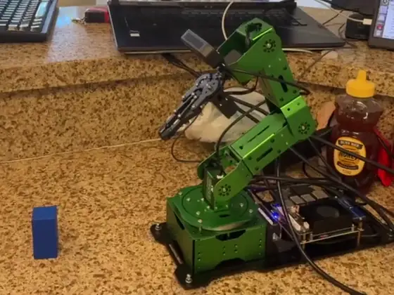
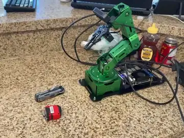
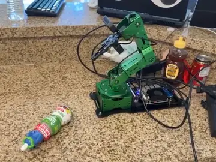
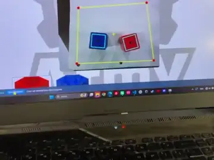
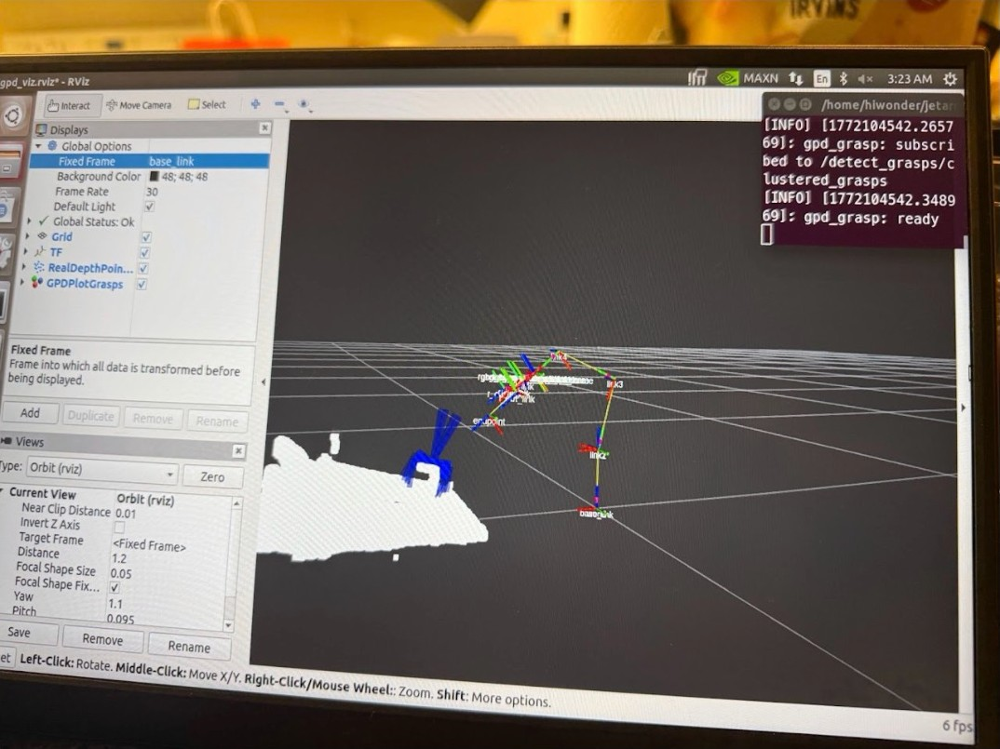
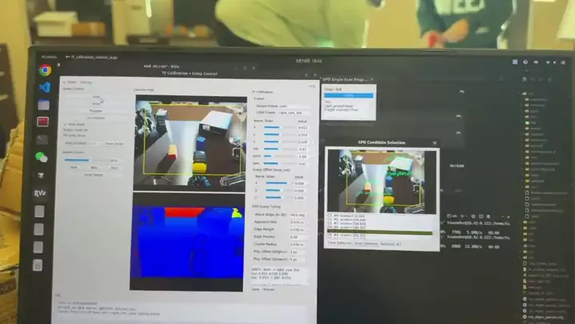
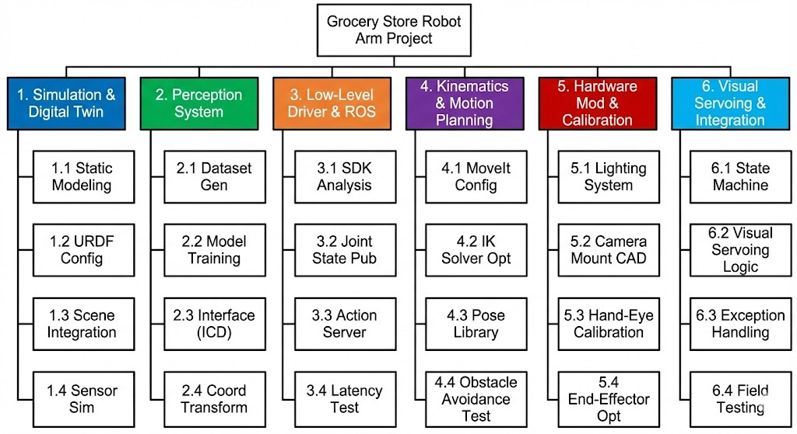

# ArmY —— 桌面机械臂上的抓取位姿选择

[English](README.md) | **中文**

**ArmY** 是毕业设计团队做的货架商品抓取机器人，基于 Hiwonder JetArm，深度相机装在手腕上。本仓库是它的抓取流水线。开源库 [GPD](https://github.com/atenpas/gpd)（Grasp Pose Detection）每次扫描会给出约一百个候选夹爪位姿；本仓库是围绕它、把这些候选变成这台机械臂上"一次抓取"的全部代码 —— **抓取选择节点**、把腕装相机点云转到机械臂基座坐标系的**点云桥接**，以及用于标定、调参和候选选择的 **PyQt5 操作界面**。

<p align="center">
  
</p>

> **项目背景** —— UC Irvine 毕业设计（MAE 151A/B），5 人团队，2025 年 10 月 – 2026 年 3 月，项目赞助人 Solmaz Kia 教授。机械设计、运动规划和电气部分由队友负责。**我负责抓取流水线**：抓取选择节点、点云桥接、操作界面，以及感知和抓取两项指标的验证。GPD 本身是上游代码，原样收录、未做修改。
> 带视频的完整介绍：[krisxia.com/army](https://krisxia.com/army.html)

## 结果

对照团队定下的指标 —— 包括没达到的：

| 指标 | 结果 | 状态 |
|---|---|---|
| 目标检测，基础组 + 杂乱组（有干扰物、部分遮挡） | **15 / 15** | 达到 |
| 抓取流程自动化 —— 操作员只需点选目标 | 检测 → 选择 → 抓取 → 取出，全程无需干预 | 达到 |
| 抓取位置误差 ± 1.0 cm 以内的样本占 95% | **7 / 10** | **未达到** |
| 单次抓取耗时 < 45 s | 10 – 60 s | **未达到** |

检测 15/15 不等于抓取 15/15：系统几乎总能看到目标，但并不总能把它的位置定得足够准、干净地抓起来。瓶颈在深度相机 —— 抓取位姿的精度取决于它所拟合的表面，而这台相机的点云边缘很毛糙。考虑货架的避障始终没做到可用状态；下面的抓取都是在开放场景和置物架上完成的。

<table>
  <tr>
    <td width="33%"></td>
    <td width="33%"></td>
    <td width="33%"></td>
  </tr>
</table>
<p align="center"><sub>同一套流水线，三种物体（2.5 倍速）。左：刚性、扁平 —— 平放的多功能工具 · 中：不规则、锥形 —— 全身没有一个平面 · 右：换房间、换桌面、换光照</sub></p>

## 工作原理

```
腕装 RGB-D 相机
   │   /rgbd_cam/depth/points（相机坐标系，每动一次关节就变）
   ▼
pointcloud_to_base          经实时 TF 转到 base_link，并降采样
   │   /rgbd_cam/depth/points_base
   ▼
gpd_once_server             gpd_ros + GPD（未修改）；操作员点选
   │                        目标时跑一次 → 排好序的候选位姿
   ▼
gpd_grasp_node              可达盒过滤 → 排序 → 接近 / 撤离
   │   /grasp 动作
   ▼
JetArm 舵机控制器
```

### 1. 从一百个候选里挑一个

要抓一个物体，机械臂需要的是空间中的一个位姿 —— 夹爪放在哪、从哪个方向来、张多大。GPD 对点云采样，返回一组排好序的候选夹爪位姿：杂乱场景下数量很多，其中不少根本没法用 —— 夹爪会穿过物体所在的台面，或者落在点云毛糙的边缘上。`gpd_grasp_node.py` 在它外面加了：

- **可达盒（reachability box）** —— 在机械臂基座坐标系里设一个保守的盒子，盒子外的候选先一律丢掉；大部分候选就是在这一步被筛掉的；
- **排序** —— 剩下的按分类器自己的打分排序，分数相同时按离"偏好点"的距离决胜；
- **执行** —— 斜向推抓（slanted push-pick），攻角、接近距离和撤离量都可配置，发给机械臂的 `/grasp` 运动动作执行。

<p align="center">
  
</p>
<p align="center"><sub>白色的是扫描得到的点云；蓝色的夹爪是在上面生成的候选抓取。</sub></p>

### 2. 让三个部件对"东西在哪"达成一致

GPD 是为固定安装的相机写的 —— 相机在外面看着场景，机械臂在场景里动。这里深度相机直接装在手腕上、夹爪正上方，所以不存在一个固定的相机到基座外参，每动一次关节，点云所在的坐标系就换一次。

这打破了 GPD 一个从没明说的假设。它用一个以米为单位的普通盒子裁剪点云 —— 这个盒子**只有在点云已经处于机械臂基座坐标系时**才对应桌面上方那块空间。如果点云还是相对手腕的，每动一次就会在一个不同的错误位置裁出一块，而且不会报任何错：机械臂会很自信地伸向一个根本不存在的位置。所以 `pointcloud_to_base.py` 先把每一帧点云经实时 TF 树转到 `base_link`，顺带降采样。

事后只变换 GPD 返回的那几个位姿，要比变换几十万个点便宜得多 —— 但裁剪发生在数据进入 GPD *之前*，未变换的点云会让 GPD 在盒子外生成大量候选，它们的分数可能高到把真正落在物体上的候选挤掉。测试中就遇到了这种情况。

### 3. 一个操作员真正能用的界面

<p align="center">
  
</p>
<p align="center"><sub>检测、候选选择和抓取，端到端（2 倍速）。</sub></p>

`tf_calibration_control_ui.py` 让所有必须在真机上调的东西都能在运行中调整，做一次实验只需拖一下滑块，不用重新编译：`link5 → rgbd_cam_link` 的手眼标定、`base_link` 下的抓取偏移、GPD 调参（攻角、接近距离、边缘余量与惩罚、候选聚类半径）、单次扫描触发、把相近候选聚类后供选择的候选选择器、机械臂速度档位，以及中英文切换。

## 仓库结构

```
gpd/                  GPD 核心库（C++，上游代码，未修改）
gpd_ros/              GPD 的 ROS 封装（上游）+ 单次检测用的 gpd_once.launch
jetarm_ui/
  scripts/
    gpd_grasp_node.py              抓取选择与执行
    pointcloud_to_base.py          腕装点云 → base_link 桥接
    tf_calibration_control_ui.py   PyQt5 操作界面
    jetarm_ui_node.py              独立的机械臂控制界面（含曝光、白平衡）
    tf_calibration_tool.py         独立的手眼标定工具
  launch/             tf_calibration_control_ui.launch（整套系统）、gpd_grasp.launch 等
  config/             tf_calibration.yaml（标定、偏移、GPD 调参）、ui_config.yaml
user_config/          用户级配置，重新部署代码时不会被覆盖
start_tf_ui.sh        部署在机械臂上的一键启动脚本
docs/media/           本 README 用到的图片和动图
```

## 编译运行

运行在 JetArm 机载电脑上，**ROS Melodic**，依赖 JetArm SDK 的包（`jetarm_bringup`、`jetarm_peripherals`、`jetarm_driver`、`hiwonder_interfaces`、`color_detection`、`lab_config`）、`astra_camera`、PCL ≥ 1.9、Eigen 3、OpenCV ≥ 3.4、Python 3 + PyQt5。

```bash
# 1. 编译 GPD 核心库
cd gpd && mkdir build && cd build && cmake .. && make -j$(nproc) && sudo make install

# 2. 把 ROS 包放进 JetArm 的 catkin 工作空间
cp -r gpd_ros jetarm_ui ~/jetarm/src/
cd ~/jetarm && catkin_make && source devel/setup.bash

# 3. 启动整套系统（相机、颜色检测、点云桥接、GPD 服务、抓取节点、界面）
./start_tf_ui.sh            # 或：roslaunch jetarm_ui tf_calibration_control_ui.launch
```

`start_tf_ui.sh` 里写死了机械臂的 `ROS_IP` / `ROS_MASTER_URI` 和工作空间路径 —— 换环境时要改。

| 配置文件 | 内容 |
|---|---|
| `gpd/cfg/ros_eigen_params.cfg` | GPD 核心参数：工作空间盒子、采样数、CNN 通道数、`weights_file` 路径 |
| `jetarm_ui/config/tf_calibration.yaml` | 手眼变换、抓取偏移、界面写入的 GPD 调参值 |
| `jetarm_ui/config/ui_config.yaml` | 界面默认配置（相机话题、机械臂姿态） |
| `user_config/ui_config.user.yaml` | 用户级覆盖配置，重新部署时不覆盖 |

<details>
<summary><b>接口（话题、服务、TF、动作）</b></summary>

**需要外部提供**

| 名称 | 类型 | 提供方 |
|---|---|---|
| `/rgbd_cam/depth/points` | `sensor_msgs/PointCloud2` | 相机驱动 |
| `/rgbd_cam/depth/image_raw` | `sensor_msgs/Image` | 相机驱动（界面显示） |
| `/rgbd_cam/color/camera_info` | `sensor_msgs/CameraInfo` | 相机驱动（投影用） |
| `/color_detection/image_result` | `sensor_msgs/Image` | `color_detection`（界面显示） |
| `/object/pixel_coords` | `hiwonder_interfaces/ObjectsInfo` | `color_detection` —— 检测到的目标 |
| `/color_detection/{enter,start,stop,exit}` | `std_srvs/Empty` | `color_detection` |
| `/rgbd_cam/set_uvc_auto_exposure`、`/rgbd_cam/set_uvc_auto_white_balance` | `std_srvs/SetBool` | `astra_camera` |
| `/rgbd_cam/set_uvc_exposure` | `astra_camera/SetInt32` | `astra_camera` |
| `/lab_config_manager/enter` | `std_srvs/Trigger` | `lab_config` |
| `/grasp`（动作） | `hiwonder_interfaces/MoveAction` | JetArm 运动控制器 |
| TF `base_link → link1 … link5` | — | URDF / `robot_state_publisher` |

**本系统提供**

| 名称 | 类型 | 节点 |
|---|---|---|
| `/rgbd_cam/depth/points_base` | `sensor_msgs/PointCloud2` | `pointcloud_to_base` |
| `/gpd_once_server/detect_grasps`（服务） | `gpd_ros/detect_grasps` | `gpd_once_server` |
| `/detect_grasps/clustered_grasps` | `gpd_ros/GraspConfigList` | `gpd_once_server` |
| `/gpd_grasp/trigger`、`/gpd_grasp/clear_cache`（服务） | `std_srvs/Trigger` | `gpd_grasp_node` |
| `/controllers/multi_id_pos_dur` | `hiwonder_interfaces/MultiRawIdPosDur` | `gpd_grasp_node` / 界面 —— 舵机 ID、位置、时长（ID 1–5 为关节，10 为夹爪） |
| `/gpd_grasp/debug_markers`、`/gpd_once_server/plot_grasps` | `visualization_msgs/MarkerArray` | RViz 调试 |
| TF `link5 → rgbd_cam_link` | — | 静态发布 / 界面标定（`tf_calibration.yaml`） |

</details>

<details>
<summary><b>我的工作在团队分工中的位置</b></summary>

<p align="center">
  
</p>

团队划分的项目结构。我的工作在感知那一列和最右边的集成那一列。

</details>

## 许可

GPD（`gpd/`、`gpd_ros/`）沿用其自身的 BSD 2-Clause 许可，见这两个目录里的许可文件。仓库其余部分仅供学习研究使用。
